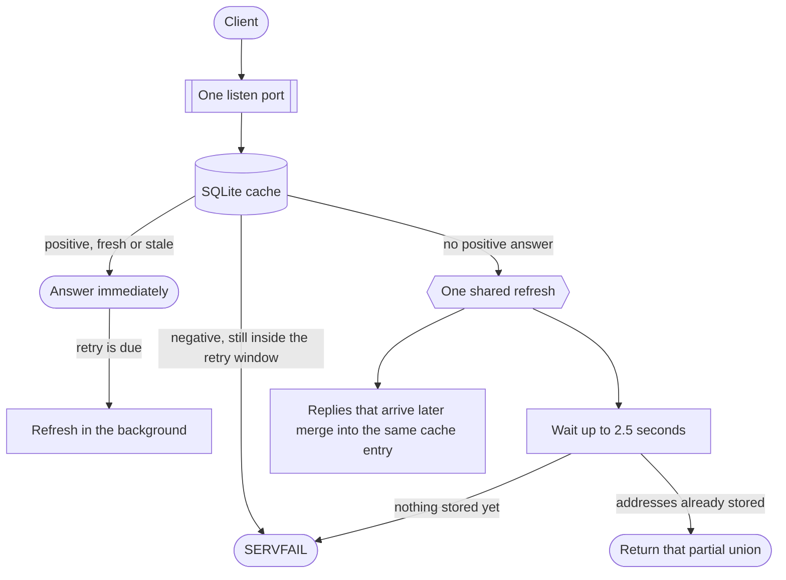
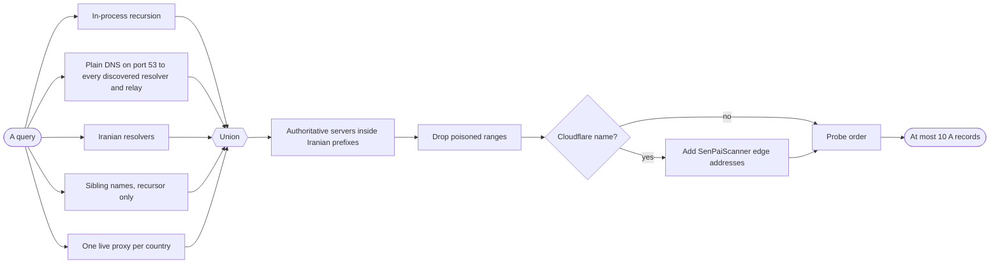
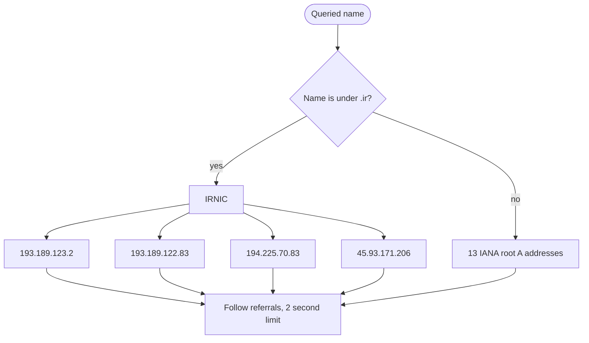
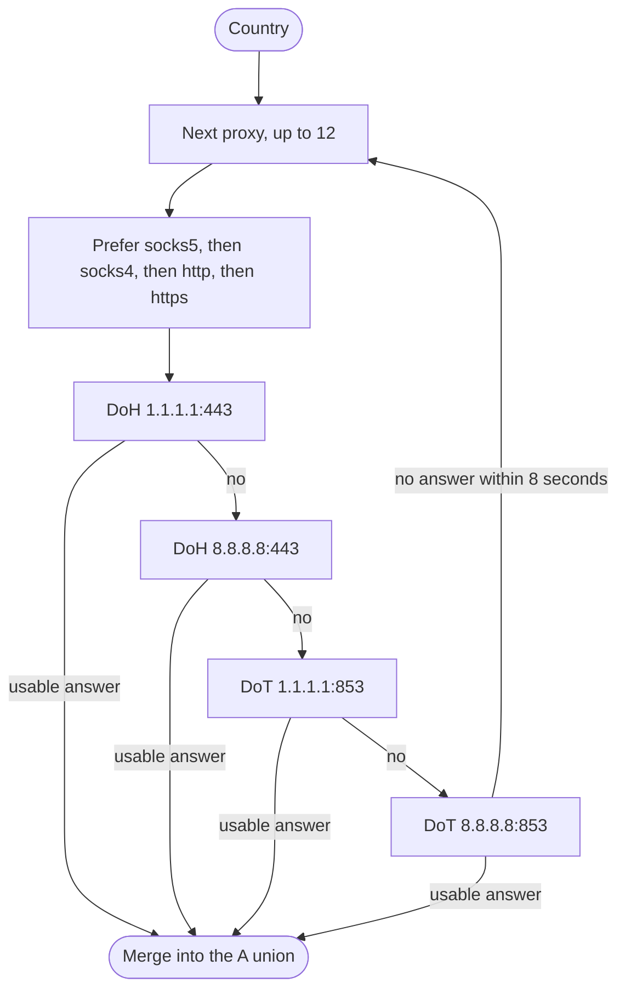
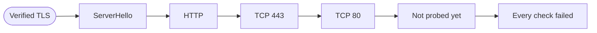

# Opinionated DNS

A caching DNS resolver for networks where answers are poisoned, filtered, or simply unreachable. It listens on one address, answers from memory and from a SQLite file, and refreshes in the background. The lists it needs to start are compiled into the binary, so a clone or a release archive answers before any download.

Clients only need that one listen address. The sample [`config.toml`](config.toml) uses `127.0.0.1:5355`, so the process does not need root.

## Why the answer is more useful than one recursive lookup

A single recursive lookup returns whatever one path can see, and it blocks the client until that path finishes. This resolver does four things differently.

**A stored answer is returned immediately, including after its TTL has expired.** The SQLite cache is checked before any network I/O. A fresh hit is served with a TTL clamped between 300 seconds and 24 hours. A stale hit is served with a 30 second TTL, and the refresh runs in the background. A long upstream outage still resolves. An empty or failed lookup is `SERVFAIL`. A stored positive answer is kept when a later lookup fails; only the next retry is delayed.

**A cold name is a parallel fan-out, and the client is not held for the slowest source.** Recursion, the discovered resolvers, the Iranian resolvers, sibling names, and one proxy per country all run at once. At 2.5 seconds the addresses collected so far are written to the cache and returned. Sources that finish later are merged into the same cache entry, so the next query is the full union and still comes from the cache.

**The address set is a union, then it is ordered by a real handshake.** Poisoned ranges are dropped. What remains is probed in the background: a verified TLS handshake, an unverified ServerHello, an HTTP response, a TCP connection to 443, a TCP connection to 80. Unprobed addresses follow those, and addresses where every check failed sort last. Faster handshakes come first inside a tier. At most 10 A records are served. Up to 64 are stored, so a later probe can promote an address that was left out of the first reply. The probe uses the queried name as SNI.

**Some addresses never appear in a lookup from one country.** CDN edges differ by geography, a name’s own authoritative servers inside Iranian prefixes answer even when public recursion is filtered, and sibling hostnames under the same registrable domain often share the addresses the client actually needs. Those are merged into the same A answer.

The response header has `RA=1` and `AA=0`. NS and glue from the in-process walk are added to the additional section when they fit. DNSSEC validation is off and the AD bit stays clear, because a merged set cannot keep one upstream signature.

## Flows

### A query, from the listen port to the reply



A second query for the same name joins the refresh already in flight. The next query after the merge is a cache hit.

### Where the addresses come from

These run together. Resolver and relay addresses are how the queries are sent. They are not the A records that get returned.



### Where recursion starts



### One country, at query time

The country list is only a candidate list. A proxy is accepted when it returns a real answer for the queried name. An answer made only of poisoned addresses is skipped.



At most 16 countries do this at once.

### Order of the A records that are served

Faster handshakes come first inside a tier. The probe uses the queried name as SNI. Up to 64 addresses are stored, so a later probe can promote one that was left out of the first reply.



## How an A answer is built

Every source below contributes addresses. Resolver and relay addresses are never returned as the answer. `10.10.0.0/16` (the Iranian filter sink, including `10.10.34.34`), `0.0.0.0/8`, `127.0.0.0/8`, `224.0.0.0/4`, and `255.255.255.255` are dropped. Other addresses in `10.0.0.0/8`, including `10.202.0.0/16`, are kept.

### Cache

The first lookup of a name pays the fan-out. Every later lookup, for as long as the process has the SQLite file, is answered from the cache before the refresh completes. Concurrent queries for the same name share one refresh.

### In-process recursion

The process walks referrals itself. Names under `.ir`, including the `.ir` apex, start at the IRNIC servers `193.189.123.2`, `193.189.122.83`, `194.225.70.83`, and `45.93.171.206`. Every other name starts at the 13 IANA root A addresses. The recursion timeout is 2 seconds.

### DNSCrypt lists, queried as plain DNS

The [DNSCrypt public resolver and relay lists](https://github.com/DNSCrypt/dnscrypt-resolvers) are used only to discover server addresses. Each refresh sends ordinary DNS to every address on port 53 and unions the answers. The query is plain DNS. A background refresh replaces a list only after its minisign signature checks against the DNSCrypt public key.

### Iranian resolvers

A fixed set of Iranian resolvers (Shecan, Electro, Begzar, Shelter, Beshkan, 403, Radar, Shatel, Pishgaman, Pars Online, TIC) is always included. The current [public-dns.info Iran list](https://public-dns.info/nameserver/ir.csv) is merged in when that download succeeds. These queries use an 800 ms timeout.

### Authoritative nameservers in Iranian prefixes

After the first replies return nameserver addresses, the resolver asks authoritative servers whose addresses fall in Iranian prefixes from [ipdeny](https://www.ipdeny.com/ipblocks/data/countries/ir.zone). That reaches a zone’s own servers when public recursion is filtered and the registry is local.

### Sibling names

For A queries, names under the same registrable domain are resolved and their addresses join the union. The registrable domain comes from the [Mozilla Public Suffix List](https://publicsuffix.org/), which is vendored in the tree. At most 16 related names are queried, using only the in-process recursor. Names learned from a verified TLS certificate are remembered for later queries. `youtube.com` stays on its own registrable domain and is not merged into `google.com`.

### One live proxy per country

A records are also collected through the country proxy lists from [IPLocate](https://github.com/iplocate/free-proxy-list/tree/main/countries). The list is refreshed every 30 minutes. That refresh only stores candidates. Public proxies go unhealthy quickly, so a proxy is tested when the query runs.

Each country tries up to 12 proxies, preferring socks5, then socks4, then http, then https, with 8 seconds per proxy. Through the proxy it sends DoH to `1.1.1.1:443` and `8.8.8.8:443`, then DoT to those addresses on port 853, until one returns a real DNS answer for the queried name. An answer that contains only poisoned addresses is skipped and the next proxy is tried. At most 16 countries run at once.

### Cloudflare edges

A name is treated as Cloudflare when an NS is under `ns.cloudflare.com`, a CNAME contains `cloudflare`, or an address falls in [Cloudflare’s published IPv4 list](https://www.cloudflare.com/ips-v4). Those names also include the edge addresses from [SenPaiScanner](https://github.com/MatinSenPai/SenPaiScanner) by MatinSenPai. The same probe order ranks them. Docker Compose runs the scanner beside the resolver and writes `cloudflare-ips.txt`. A failed scan keeps the previous file, and a snapshot is already embedded for the first start.

## Other record types

AAAA, NS, CNAME, MX, TXT, SOA, PTR, HTTPS, and SVCB use the same sources, the same poison filter, and the same stale cache. They are not ordered by the port probes. Caps are 10 for AAAA, 8 for NS, MX, TXT, HTTPS, and SVCB, 4 for CNAME and PTR, and 2 for SOA.

## Credits

- [DNSCrypt resolvers](https://github.com/DNSCrypt/dnscrypt-resolvers) — the signed public resolver and relay lists used to discover servers.
- [SenPaiScanner](https://github.com/MatinSenPai/SenPaiScanner) by MatinSenPai — the Cloudflare edge scan.
- [ipdeny](https://www.ipdeny.com/ipblocks/data/countries/ir.zone) — Iranian IP prefixes.
- [public-dns.info](https://public-dns.info/nameserver/ir.csv) — additional Iranian resolvers.
- [Cloudflare IP ranges](https://www.cloudflare.com/ips-v4) — prefixes used to recognize Cloudflare names.
- [IPLocate free proxy list](https://github.com/iplocate/free-proxy-list/tree/main/countries) — one proxy list per country.
- [Mozilla Public Suffix List](https://publicsuffix.org/) — registrable-domain boundaries for sibling names.

## Run with Docker

From `deploy/`:

```sh
docker compose up --build
```

The resolver is published on `127.0.0.1:5355`, UDP and TCP. Inside the Compose network it also answers at `172.30.53.53`. The SenPaiScanner loop stays on that internal network. SQLite and refreshed lists live in the `resolver-data` volume. The container listens on `0.0.0.0:53`; the host port is 5355.

Point a client at `127.0.0.1:5355`. Nothing else in the stack needs to be configured on the client.

## Run the binary

Install a current stable Rust toolchain and a C compiler. The build compiles SQLite into the binary.

Linux:

```sh
sudo apt-get install build-essential
cargo run --release -- config.toml
```

macOS, with the Xcode command line tools installed:

```sh
cargo run --release -- config.toml
```

Windows, from a Visual Studio developer prompt or any shell where `cargo` can find the MSVC build tools:

```powershell
cargo run --release -- config.toml
```

The binary is `target/release/opinionated-dns` (`opinionated-dns.exe` on Windows). It reads the config path from the first argument, or `config.toml` in the current directory. `data_dir` is created if it is missing. Background refresh writes updated lists there when the network allows it. Until that happens, the embedded snapshots are used.

Release archives on the GitHub release page contain the binary, `config.toml`, and `SHA256SUMS`. The lists are inside the binary.

```sh
dig @127.0.0.1 -p 5355 example.com
```

### systemd

`/etc/systemd/system/opinionated-dns.service`:

```ini
[Unit]
Description=Opinionated DNS
After=network-online.target
Wants=network-online.target

[Service]
ExecStart=/usr/local/bin/opinionated-dns /etc/opinionated-dns/config.toml
Restart=on-failure
DynamicUser=yes
StateDirectory=opinionated-dns
WorkingDirectory=/var/lib/opinionated-dns
NoNewPrivileges=yes

[Install]
WantedBy=multi-user.target
```

Copy `config.toml` to `/etc/opinionated-dns/config.toml` and set `data_dir` to `/var/lib/opinionated-dns`. Keep `listen` on port 5355 so the dynamic user can bind it.

```sh
sudo systemctl enable --now opinionated-dns
```

## Optional DNS-over-HTTPS front

[`deploy/doh-proxy.py`](deploy/doh-proxy.py) is a small RFC 8484 front. It listens on `127.0.0.1:8053` and forwards `/dns-query` (GET `dns=` and POST `application/dns-message`) to a resolver on `127.0.0.1:53`. The sample config listens on port 5355, so change `UPSTREAM` in the script to `("127.0.0.1", 5355)`, or set `listen` to `127.0.0.1:53` in the config you run locally.

```sh
python3 deploy/doh-proxy.py
```

Put your own TLS terminator in front of port 8053 if clients should use HTTPS. The script speaks plain HTTP to localhost.
